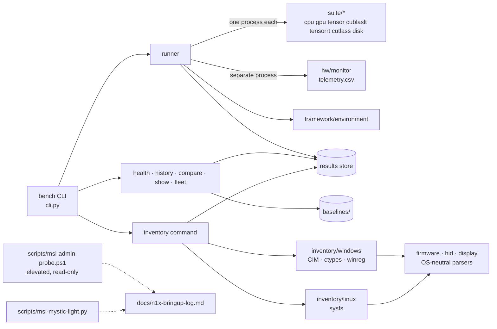

# anvesana: node health benchmarks: architecture

The design of the code for [[PRJ-0001]]. Decisions with their alternatives are recorded one
per file in `decisions/`; this document says how the pieces fit and links them. The
machine-specific findings (what the N1X laptop is made of, what worked, what failed) are in
`n1x-bringup-log.md`.

## Goals and constraints

anvesana does two jobs for a fleet of GPU/ARM machines:

1. **Node health.** Run the same benchmark suite (CPU, memory, disk, GPU, tensor cores,
   cuBLASLt, TensorRT, CUTLASS) on every machine on a schedule, keep every run, and flag
   machines that are getting slower, hotter or broken.
2. **Platform bring-up.** On a new SoC, record what the hardware is and which driver runs
   each part, so that an OS port (here: Linux on the NVIDIA RTX Spark N1X, which ships with
   Windows on ARM) has a reference and a measurable gap list.

Constraints:
- Every node installs only what its profile needs, from one shared `uv.lock`
  (win_arm64, linux_aarch64, linux_x86_64). Hardware stacks are optional extras; a missing
  GPU stack must not break CPU or disk benchmarks.
- Results are comparable only when measured the same way: each benchmark has a methodology
  `VERSION`, and `health`, `history` and `compare` refuse to compare across a change.
- Collection must work without administrator rights where possible (ADR-0002). Anything that
  needs admin, or could change hardware state, is a separate, read-only tool (ADR-0008,
  ADR-0009).
- Records may be shared beyond the team: no product keys, serial numbers or user names in
  JSON (ADR-0004).
- The same code runs on Windows and Linux. Windows paths use CIM, PowerShell and ctypes;
  Linux paths use sysfs.

## Data model

| Noun | Identity | Where | Source of truth / derived |
|---|---|---|---|
| Machine profile | `machines/<id>.toml` | repo | Source: benchmarks and args, OS limits, advertised specs (`[expected]`), health tolerances, extras |
| Run | `<machine>_<YYYY-MM-DD_HHMMSS>_<os>[_tag]` | `$ANVESANA_RESULTS_DIR/<machine>/<run>/` | Source: `run.json` (settings, environment, phases, per-phase telemetry summary, metrics), `telemetry.csv`, `run.log` |
| Baseline | `<machine>/<os>` | `baselines/<machine>/<os>.json` (committed) | A promoted `run.json`: the health-check reference |
| Metric | `<benchmark>.<measure>[.<qualifier>]` | inside `run.json` | Headline metrics (one dot) are health-checked; sub-metrics (power, clock, efficiency) are context |
| Inventory snapshot | `<machine>_<YYYY-MM-DD_HHMMSS>_<os>` | `<store>/<machine>/inventory/<snapshot>/` | Source: `inventory.json` (schema 1), plus raw files: `acpi/*.dat`, `smbios.bin`, `display/*.edid`, `display/color/*.icm`, `hid/*.bin`, `drivers/<pkg>/*.inf`, `power/*.txt`, `kernel.log` (ADR-0001, ADR-0004) |
| Device | `match_id` (`acpi:NVDA0200`, `pci:10de:2e03`, `usb:…`, `wmi:<GUID>`) plus ACPI path | inside a snapshot | Join key for cross-OS comparison (ADR-0003) |
| Firmware blob | `<sha256[:16]>_<name>` | `<store>/<machine>/inventory/firmware/` | Content-addressed copies, shared by a machine's snapshots (ADR-0005) |
| Bring-up log | one document | `docs/n1x-bringup-log.md` | Human-readable findings with confidence markers; the snapshots are its evidence |

Run references accept a path, a run id, `<machine>[@latest|@-1|@<date>|@baseline[:<os>]]`.
Snapshot references follow the same pattern, plus `@windows` / `@linux` for the newest
snapshot from an OS.

Everything in the results store is the record; the repo holds only code, profiles, committed
baselines and documents. Telemetry summaries in `run.json` are derived from `telemetry.csv`
and kept so a committed baseline is self-contained.

## Components

**Benchmark framework** (`src/anvesana/framework/`, `suite/`, `hw/`):
- **`runner`.** Resolves the machine profile, starts the telemetry monitor in its own
  process (rows tagged by phase), then runs an idle baseline and each benchmark in a fresh
  Python process with cooldowns. A crash or leaked GPU memory can't affect the next
  benchmark, and TensorRT / TensorRT-RTX never share a process. It writes `run.json`, then
  optionally health-checks.
- **`registry`.** Declares each benchmark's extras, required tools, OSes and hardware
  probe, so readiness (`bench check`) is known without importing missing packages.
- **`provision`.** `bench setup` runs `uv sync --locked` with exactly the extras the
  profile needs on this OS.
- **`health`.** Compares headline metrics with the baseline, or the median of the last 3
  runs, using per-metric tolerance globs. It also flags hotter or lower-clocked operation
  under the same load. It exits 1 on FAIL or MISSING.
- **`environment`.** Captures OS, kernel, CPU, RAM, power profile, AC state, NVIDIA driver
  and libraries, GPU power limit, and BIOS and system product (ADR-0010).
- **Scheduled runs.** `scripts/scheduled-run.{ps1,sh}` wrap setup, inventory collection
  and run plus health for Task Scheduler and cron.

**Inventory** (`src/anvesana/inventory/`, `bench inventory collect | list | show | compare`):

| Module | Collects |
|---|---|
| `windows` | PnP devices with drivers, filters, INF, version, problem code, ACPI path and MMIO/IRQ resources; kernel driver services; third-party driver packages (INFs copied, files hashed, firmware optionally copied); ACPI tables, including every SSDT via the registry mirror; raw SMBIOS; per-core CPU ID registers; HID collections from `hid.dll` caps (ADR-0007); ESRT; display paths, modes and HDR via the CCD API, plus EDIDs, brightness and ICC profiles; power (sleep states, plan, overlay, every `powercfg` setting); OEM vendor settings with identifiers removed |
| `linux` | The same schema from sysfs: ACPI devices (driver from the physical node), PCI, USB, platform and WMI devices; deferred probes; modules; kernel log with missing-firmware and probe-error extraction; ACPI tables and SMBIOS (root); HID report descriptors; DRM connectors and backlight; `/sys/power`, platform profile, governors |
| `firmware` | OS-neutral parsers: ACPI table headers and `_WDG` (ACPI-WMI) blocks; SMBIOS summary and dump; ARM64 MIDR / system-register naming |
| `hid` | Report-descriptor parser and usage names |
| `display` | EDID parser: base block, CTA-861 HDR metadata, DisplayID 2.0 timings |
| `snapshot` | Store layout, schema, collection and reference resolution |
| `command` | `show` tables, and `compare` with verdicts (ADR-0006) |

**Vendor-control tools** (`scripts/`):
- **`msi-admin-probe.ps1`.** An elevated, guided script that dumps the `MSI_ACPI` WMI
  getters per power mode, together with MSI Center's registry view, and traces USB while
  the lighting changes. It never calls a setter (ADR-0008).
- **`msi-mystic-light.py`.** Drives the keyboard RGB controller (`1462:1609`) with the
  protocol taken from MSI's code. It refuses save-to-flash (ADR-0009).

**Notebook.** `notes/` is a yajna `project` notebook (`yajna.toml`): the project page,
agent sessions and the daily log. Its files are kept LF (ADR-0011).

## Stack

- **Python ≥ 3.12, managed by uv.** One lock for the fleet; per-node extras; `uv run bench`.
- **numpy, psutil (core).** CPU, memory and disk benchmarks; telemetry; run records.
- **Extras:**
  - `nvidia`: cuda-python, NVRTC, cuBLAS, NVML. PTX and NVRTC kernels mean no CUDA toolkit
    install.
  - `tensorrt`: TensorRT for RTX on both OSes; full TensorRT on Linux only, because its
    win_arm64 wheel lacks the Myelin resources.
  - `cutlass`: CUTLASS 4.2 profiler, Linux only, since MSVC cannot compile its SM90+ kernels.
- **Windows platform access.** PowerShell 5.1 (CIM, `Get-PnpDeviceProperty`) called once
  per collection, plus ctypes against `kernel32`, `setupapi`, `hid` and `user32`, and
  `winreg`. No pywin32 dependency (ADR-0002).
- **Linux platform access.** sysfs and procfs only; `dmesg` / `journalctl` for the kernel
  log.
- **Tools used for investigation, not dependencies.** `dnfile` (via `uv run --with`) to
  read .NET metadata; ETW (`logman`, `tracerpt`) for USB tracing.

## Phases

| Phase | Deliverable | Check that proves it |
|---|---|---|
| 0. Node health | Benchmark suite, run records, baselines, health, fleet, scheduled runs (before this notebook) | `bench run --health` on bbaum-pc-7; baseline `baselines/bbaum-pc-7/windows.json` |
| 1. Windows reference inventory | `bench inventory` on Windows: devices, drivers, firmware, CPU, HID, WMI, ESRT, display, power, vendor settings | Snapshots of bbaum-pc-7 collect unprivileged in about 50 s; `show` lists all 32 NVIDIA ACPI devices with drivers and resources |
| 2. Vendor controls mapped | MSI power modes, EC firmware, keyboard RGB protocol | Admin probe: 13 getters, 5 modes mapped to `Get_AP` byte 3; RGB steady, zones and effects confirmed on hardware |
| 3. Linux inventory on hardware | First Linux boot of the N1X: `sudo bench inventory collect` | Snapshot collects; `compare <machine>@windows <machine>@linux` produces the gap list; ACPI tables identical across OSes |
| 4. Close the gap list | Drivers, firmware and quirks for each GAP / MISSING, controllers before devices behind them | `inventory compare` exits 0 for the SoC blocks |
| 5. Benchmarks on Linux | Same suite on Linux, including the Linux-only TensorRT and CUTLASS | Linux baseline promoted; `bench compare <machine>@baseline:windows <machine>@baseline:linux` |
| 6. Platform controls on Linux | Power-mode, keyboard RGB and backlight tools on Linux | Modes switch via `MSI_ACPI` (or a kernel driver); RGB via hidraw |

## Open questions

- **Linux collector on hardware.** It has only been tested against a synthetic sysfs:
  real symlinks, deferred-probe reasons and kernel-log parsing are unverified. Phase 3 is
  the test.
- **EC writes from Linux.** Is `Set_AP` with the `Get_AP` layout safe, and which bytes hold
  the battery charge limit? This needs one deliberate write test, after reading the method
  in the DSDT (`iasl`).
- **The `5B3CC38A-…` WMI event (notify 0xC0).** What does it carry: hotkeys, tablet mode,
  AC? Answered from the DSDT, or from a Linux `wmi` event dump.
- **Tablet mode.** MSI Center sets `ConvertibleSlateMode` itself, so Linux needs a
  `SW_TABLET_MODE` source, perhaps the sensor hub's hinge angle. Open until the sensor hub's
  descriptors are read on Linux.
- **Pen protocol.** MPP 2.x or USI? The pen reports a 32-bit transducer serial; the ELAN
  vendor collections may tell.
- **ESRT device firmware.** Which component does each of the three "Device Firmware" GUIDs
  update?
- **Inventory speed.** About 30 s of the collection is the per-device property sweep;
  SetupAPI would be faster if it ever matters.
